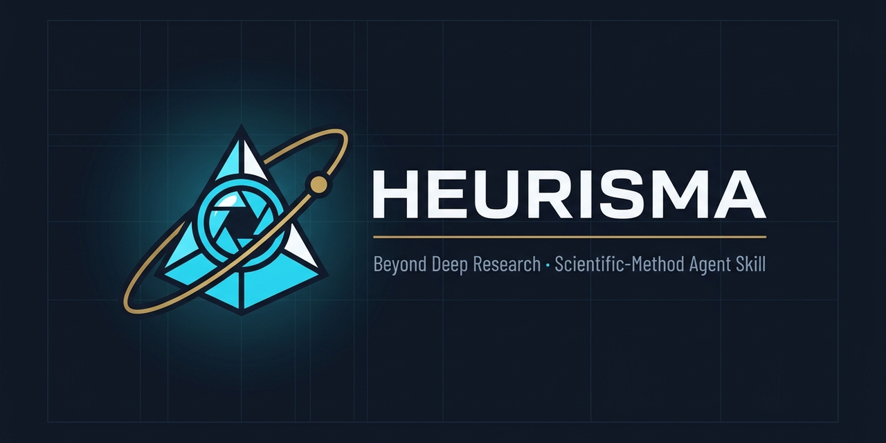
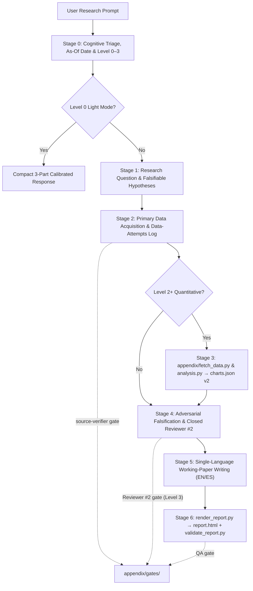

<p align="center">
  
</p>

<p align="center">
  <strong>Beyond Deep Research: a scientific-method agent skill for discipline-aware inquiry, reproducible data analysis with an online → local data cascade, three independent subagent gates, and publication-grade working-paper reports.</strong>
</p>

<p align="center">
  <a href="https://github.com/777aeterna/heurisma/actions/workflows/validate-skill.yml">
    
  </a>
  
  
  
  
  
</p>

---

## Why Heurisma? (Beyond Deep Research)

Conventional **Deep Research** tools are primarily *retrieval and summarization engines*: they search the web, mix press releases with peer-reviewed studies, and output long dashboard-style essays that sound authoritative even when the underlying evidence is weak or unverified.

**Heurisma** (from Greek *heuriskein*, "to discover") forces an AI agent to **think and publish like a scientist**:

| Dimension | Conventional Deep Research | Heurisma (`v0.6.0`) |
| :--- | :--- | :--- |
| **Before Searching** | Launches queries immediately | **Pre-Search Gate:** classifies scientific branch(es), `As-Of Date`, evidence standards, and depth level (`Level 0–3`) first |
| **Hypotheses & Forecasts** | Implicit narrative confirmation | Explicit **$H_0$ / $H_1$ falsifiable hypotheses** + multi-scenario forecasting (*identities ≠ forecasts*) |
| **Data & Provenance** | Eyeballs tables or declares lazy "data limitations" | Reproducible `appendix/fetch_data.py` + `analysis.py` + `sources.csv` (with source `kind`) + a dated **Data-Attempts Log**; a 4-rung cascade (online primary → alternatives → the user's local files → limitation), and failures inherited from an earlier run never count |
| **Numbers in the Text** | Retyped by hand, drift from the analysis | `{{num:key}}` placeholders filled from `appendix/numbers.json`, written by the analysis itself |
| **Confirmation Bias** | Summarizes consensus narrative | Mandatory **Counter-Evidence** + independent **Reviewer #2** with closed **Disposition Table** (verify or exclude reviewer facts) + a **source-verifier** gate before writing |
| **Deliverables & Figures** | Wall of text or bloated code dumps | Clean `report.md` + lightweight, print-ready **working-paper `report.html`** with zero-dependency **inline SVG charts** (`line`, `bar`, `fan`, `bands`, `annotations`, `log`, wrapped/horizontal bars, truncated-axis notice, "last data" marker), byte-for-byte reproducible |
| **Verification** | Unchecked prose | Zero-dependency **bilingual (EN/ES) validator** checking structure, substance, `[Strong]` vs. Tier 3/press bans, figure/number markers, stale HTML, contradictory provenance, failures inherited from earlier runs, and `--html`; plus three **subagent gates** (Reviewer #2, source-verifier, QA) whose answers are kept in `appendix/gates/` |

> **Transparency Note:** This skill was **vibecoded** — designed, written, and iteratively pressure-tested with AI agents (including independent cross-model audits between Gemini and Claude) following the *Superpowers* methodology (strict **RED → GREEN → REFACTOR** TDD applied to agent skills).

---

## Cognitive Architecture (7 Stages, Levels 0–3)



### Modular Structure (`skills/heurisma/`)
- **[`SKILL.md`](skills/heurisma/SKILL.md):** Lean, runtime-agnostic core enforcing the 4 Iron Laws, adaptive depth (`Level 0–3`), abstract-style verdict limits (≤3 sentences, ≤5 numbers), single-language discipline, and Stage 6 deliverables.
- **[`references/disciplines.md`](skills/heurisma/references/disciplines.md):** Taxonomy of 6 scientific branches + Interdisciplinary Bridge Protocol.
- **[`references/data-protocol.md`](skills/heurisma/references/data-protocol.md):** Reproducible `fetch_data.py`, `sources.csv`, `data_attempts.csv`, MAD + Bootstrap 95% CI template, and direct `charts.json` emission.
- **[`references/forecasting.md`](skills/heurisma/references/forecasting.md):** Multi-scenario triggers, base rates, historical error calibration, lagging-series nowcasting, and the *identity-vs-forecast* rule.
- **[`references/agents/`](skills/heurisma/references/agents):** Portable prompts for the three subagent gates — **Reviewer #2**, **source-verifier**, and **QA** — each with a fixed input and output contract (Claude Code definitions mirrored in [`agents/`](agents)).
- **[`references/adversarial-review.md`](skills/heurisma/references/adversarial-review.md):** Self-falsification checklist, **Reviewer #2** prompt template, mandatory Disposition Table (EN/ES), and primary verification rule.
- **[`references/scientific-writing.md`](skills/heurisma/references/scientific-writing.md):** Epistemic calibration scale, 100% English and 100% Spanish contracts, and `charts.json` v2 specification.
- **[`references/example-report.md`](skills/heurisma/references/example-report.md):** Compact gold-standard working-paper reference example.
- **[`scripts/local_data.py`](skills/heurisma/scripts/local_data.py):** Zero-dependency local data engine (`inventory`, `preview`, `read_table`, European CSV with `;`/decimal-comma/`latin-1`, stdlib XLSX reader + `excel_date`, JSON, `import` that copies a user file into `appendix/data/` and registers it with a relative path + SHA-256 in one step, and `HEURISMA_OFFLINE=1` to rehearse the local-data rung with the network off).
- **[`scripts/svg_charts.py`](skills/heurisma/scripts/svg_charts.py):** Zero-dependency publication SVG engine (Heckbert ticks on Y and numeric X, calendar-year date axes, Okabe-Ito palette + print dash styles, automatic >30-pt marker hiding, `bands`, staggered non-overlapping `annotations`, white-halo reference labels, scatter `y=0` & `highlight`, `percent`/`thousands`/`currency` locale formatting, localized 3-layer `fan` charts, grouped `bar`, safe `log` scale).
- **[`scripts/render_report.py`](skills/heurisma/scripts/render_report.py):** Zero-dependency working-paper HTML renderer (serif typography, 720px column, booktabs tables, small-caps tags, linked `[@C1]` citations ordered by appearance, full `en`/`es` localization, currency-safe inline math conversion, nested lists, inline `{{fig:id}}` figures, `{{num:key}}` substitution, `@media print` A4 rules, and a source hash for stale-HTML detection, absolute paths never shown, and strict appendix filtering excluding raw data/binaries).
- **[`scripts/validate_report.py`](skills/heurisma/scripts/validate_report.py):** Zero-dependency bilingual (EN/ES) validator checking headings, substance, Section 2 hypotheses, per-row matrix tags, `[Strong]` vs. Tier 3/press bans, `{{fig:id}}` & `[@id]` consistency, Spanish HTML chrome purity, provenance (local SHA-256, source `kind`, orphan `appendix/data/`, canonical and dated `data_attempts.csv`, inherited failures), unresolved markers, stale HTML (also under `python3 -I`), subagent gate traces in `appendix/gates/`, `numbers.json` coverage, hygiene, `--level 2|3`, `--html`, and `--strict`.

---

## Installation (Cross-Runtime)

Heurisma follows the open [Agent Skills Specification](https://agentskills.io/specification) and works out of the box across **Antigravity (`agy`)**, **Claude Code**, **Codex**, and **Gemini CLI**:

```bash
# Clone the repository
git clone https://github.com/777aeterna/heurisma.git

# Install globally for Antigravity / Codex / Gemini CLI (~/.agents/skills/)
mkdir -p ~/.agents/skills
cp -r heurisma/skills/heurisma ~/.agents/skills/heurisma

# Or install globally for Claude Code (~/.claude/skills/), plus the three optional subagents
mkdir -p ~/.claude/skills ~/.claude/agents
cp -r heurisma/skills/heurisma ~/.claude/skills/heurisma
cp heurisma/agents/*.md ~/.claude/agents/
```

Or download `heurisma-skill-v0.6.0.zip` from the [latest release](https://github.com/777aeterna/heurisma/releases/latest): it holds `heurisma/` (the skill) and `claude-agents/` (the subagent definitions).

---

## Showcase Examples & CLI Tools

Inspect validated outputs generated with Heurisma:
- **Live Prompt → Output Showcase (unknown-origin local CSV capped at `[Preliminary]`, exact permutation tests, sources actually read, gate records with their open problems):** [`examples/showcase-hybrid-work/PROMPT.md`](examples/showcase-hybrid-work/PROMPT.md) → [`report.md`](examples/showcase-hybrid-work/report.md) · [`report.html`](examples/showcase-hybrid-work/report.html) · [`appendix/`](examples/showcase-hybrid-work/appendix)
- **Level 1 — Rigorous Inquiry (Pressure-Tested Board Brief):** [`examples/level1-brief-example.md`](examples/level1-brief-example.md)
- **Level 2 — Empirical Data Study (Working-Paper Format + Reproducible Appendix):** [`examples/level2-study/report.md`](examples/level2-study/report.md) + [`examples/level2-study/appendix/`](examples/level2-study/appendix)

Render and validate locally with zero external dependencies:

```bash
python3 -B examples/level2-study/appendix/analysis.py --charts-out examples/level2-study/charts.json --numbers-out examples/level2-study/appendix/numbers.json > examples/level2-study/appendix/output.txt
python3 -B skills/heurisma/scripts/render_report.py examples/level2-study/report.md \
  --out examples/level2-study/report.html \
  --charts examples/level2-study/charts.json \
  --appendix examples/level2-study/appendix
python3 -B skills/heurisma/scripts/validate_report.py examples/level2-study/report.md \
  --level 2 --html examples/level2-study/report.html --strict
```

---

## Verification & Quality Assurance

- **113/113 unit tests passing** across [`tests/test_local_data.py`](tests/test_local_data.py), [`tests/test_svg_charts.py`](tests/test_svg_charts.py), [`tests/test_render_report.py`](tests/test_render_report.py), [`tests/test_validate_report.py`](tests/test_validate_report.py), and [`tests/test_agents_sync.py`](tests/test_agents_sync.py).
- **Subagents (optional):** portable prompts in [`skills/heurisma/references/agents/`](skills/heurisma/references/agents) and Claude Code definitions in [`agents/`](agents) (copy them to `~/.claude/agents/`): `heurisma-reviewer` (Opus), `heurisma-source-verifier` and `heurisma-qa` (Sonnet). The skill falls back to running the same checks inline when your runtime has no subagent tool. Either way, each gate's answer is saved to `appendix/gates/{source_verifier,reviewer,qa}.md` and checked by the validator.
- **Cold-start subagent tests of the skill text:** each new rule is written only after its baseline failure is observed. Examples: own code registered as Tier 1 went from 3/3 to 0/3, and reusing an inherited "no such series" limitation went from the audited failure to 0/3.
- **Skill TDD evals:** 4/4 RED baseline failures ([`evals/baselines/baseline-report.md`](evals/baselines/baseline-report.md)) → 6/6 GREEN passes ([`evals/results/green-eval-report.md`](evals/results/green-eval-report.md)), hardened further through two full external Claude audits (`v0.1 → v0.2 → v0.3`).

---

## Contributing & License

Contributions (especially new discipline protocols in `references/disciplines.md` and pressure scenarios in `evals/scenarios/`) are welcome — see [`CONTRIBUTING.md`](CONTRIBUTING.md).

Released under the [MIT License](LICENSE) © 2026 [777aeterna](https://github.com/777aeterna).
