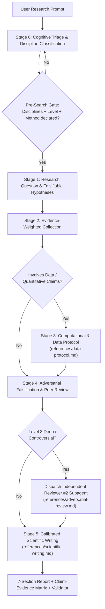

<p align="center">
  
</p>

<h1 align="center">Heurisma</h1>

<p align="center">
  <strong>Beyond Deep Research: a scientific-method agent skill for discipline-aware inquiry, reproducible data analysis, adversarial falsification, and calibrated scientific writing.</strong>
</p>

<p align="center">
  <a href="https://github.com/777aeterna/heurisma/actions/workflows/validate-skill.yml">
    
  </a>
  
  
  
  
</p>

---

## Why Heurisma? (Beyond Deep Research)

Conventional **Deep Research** tools are primarily *retrieval and summarization engines*: they search the web, blend press releases with peer-reviewed studies, and output glossy essays that sound authoritative even when the underlying evidence is weak or contradictory.

**Heurisma** (from Greek *heuriskein*, "to discover") forces an AI agent to **think like a scientist before searching**:

| Dimension | Conventional Deep Research | Heurisma |
| :--- | :--- | :--- |
| **Before Searching** | Launches queries immediately | **Pre-Search Gate:** classifies scientific branch(es), evidence standards, and depth level first |
| **Hypotheses** | Implicit narrative confirmation | Explicit **$H_0$ / $H_1$ falsifiable hypotheses** and refutation criteria |
| **Data & Numbers** | Eyeballs tables or cites unverified stats | **Reproducible Python execution** with outlier/leverage and non-parametric sensitivity checks |
| **Source Quality** | Mixes OEM press releases, blogs, and RCTs | Strict **Tier 1 / Tier 2 / Tier 3** domain evidence hierarchy |
| **Confirmation Bias** | Summarizes consensus narrative | Mandatory **Counter-Evidence** section + independent **Reviewer #2** subagent at Level 3 |
| **Uncertainty** | Naked binary verdicts or vague hedging | Explicit calibration tags (`[Strong]`, `[Moderate]`, `[Preliminary]`, `[Speculative]`) + **Claim-Evidence Matrix** |

> **Transparency Note:** This skill was **vibecoded** — designed, written, and iteratively pressure-tested with AI agents following the *Superpowers* methodology (strict **RED → GREEN → REFACTOR** TDD applied to agent skills).

---

## Cognitive Architecture



### Modular Structure
- **[`skills/heurisma/SKILL.md`](skills/heurisma/SKILL.md):** Lean core enforcing the 3 Iron Laws, Pre-Search Gate, adaptive depth selector (Level 1 / 2 / 3), positive 7-section Output Contract, and anti-pressure rationalization table.
- **[`skills/heurisma/references/disciplines.md`](skills/heurisma/references/disciplines.md):** Taxonomy of 6 scientific branches (*Formal, Natural/Physical, Biomedical/Health, Social/Economics, Engineering/Applied, Humanities/Historical*) + Interdisciplinary Bridge Protocol.
- **[`skills/heurisma/references/data-protocol.md`](skills/heurisma/references/data-protocol.md):** Zero-dependency Python audit workflow (outlier leverage, Pearson vs. Spearman, causal/confounder checks).
- **[`skills/heurisma/references/adversarial-review.md`](skills/heurisma/references/adversarial-review.md):** Self-falsification checklist + copy-ready **Reviewer #2** subagent dispatch prompt.
- **[`skills/heurisma/references/scientific-writing.md`](skills/heurisma/references/scientific-writing.md):** Epistemic calibration scale (`[Strong]`, `[Moderate]`, `[Preliminary]`, `[Speculative]`) and high-signal prose rules.
- **[`skills/heurisma/scripts/validate_report.py`](skills/heurisma/scripts/validate_report.py):** Zero-dependency Python CLI verifying that any generated report satisfies all structural and epistemic gates.

---

## Installation (Cross-Runtime)

Heurisma follows the open [Agent Skills Specification](https://agentskills.io/specification) and works out of the box across **Antigravity (`agy`)**, **Claude Code**, **Codex**, and **Gemini CLI**:

```bash
# Clone the repository
git clone https://github.com/777aeterna/heurisma.git

# Install globally for Antigravity / Codex / Gemini CLI (~/.agents/skills/)
mkdir -p ~/.agents/skills
cp -r heurisma/skills/heurisma ~/.agents/skills/heurisma

# Or install globally for Claude Code (~/.claude/skills/)
mkdir -p ~/.claude/skills
cp -r heurisma/skills/heurisma ~/.claude/skills/heurisma
```

To install **per-project**, copy `heurisma/skills/heurisma` into `<your-project>/.agents/skills/heurisma`.

---

## Showcase Examples & Report Validation

Inspect real outputs generated with Heurisma:
- **Level 1 — Rigorous Inquiry (Pressure-Tested Board Brief):** [`examples/level1-brief-example.md`](examples/level1-brief-example.md)
- **Level 2 — Empirical Data Study (Outlier Leverage Audit + Script):** [`examples/level2-data-study-example.md`](examples/level2-data-study-example.md) + [`examples/scripts/analyze_example.py`](examples/scripts/analyze_example.py)

Validate any generated report locally with zero external dependencies:

```bash
python3 skills/heurisma/scripts/validate_report.py examples/level1-brief-example.md
python3 skills/heurisma/scripts/validate_report.py examples/level2-data-study-example.md
```

---

## Skill TDD Verification (RED → GREEN → REFACTOR)

Heurisma was developed strictly test-first against adversarial pressure scenarios:
- **RED Baseline ([`evals/baselines/baseline-report.md`](evals/baselines/baseline-report.md)):** Without Heurisma, a fast model failed 4/4 scenarios — caving to binary `"YES/NO"` board pressure, mixing OEM press releases with peer-reviewed physics, and reporting statistics without runnable scripts.
- **GREEN & REFACTOR ([`evals/results/green-eval-report.md`](evals/results/green-eval-report.md)):** With Heurisma active, fresh-context `flash` subagents passed **6/6** scenarios (including unseen Formal Sciences counterexample and Level 3 power-grid multi-disciplinary conflict tests), with all loopholes closed.

---

## Contributing & License

Contributions (especially new discipline protocols in `references/disciplines.md` and pressure scenarios in `evals/scenarios/`) are welcome — see [`CONTRIBUTING.md`](CONTRIBUTING.md).

Released under the [MIT License](LICENSE) © 2026 [777aeterna](https://github.com/777aeterna).
