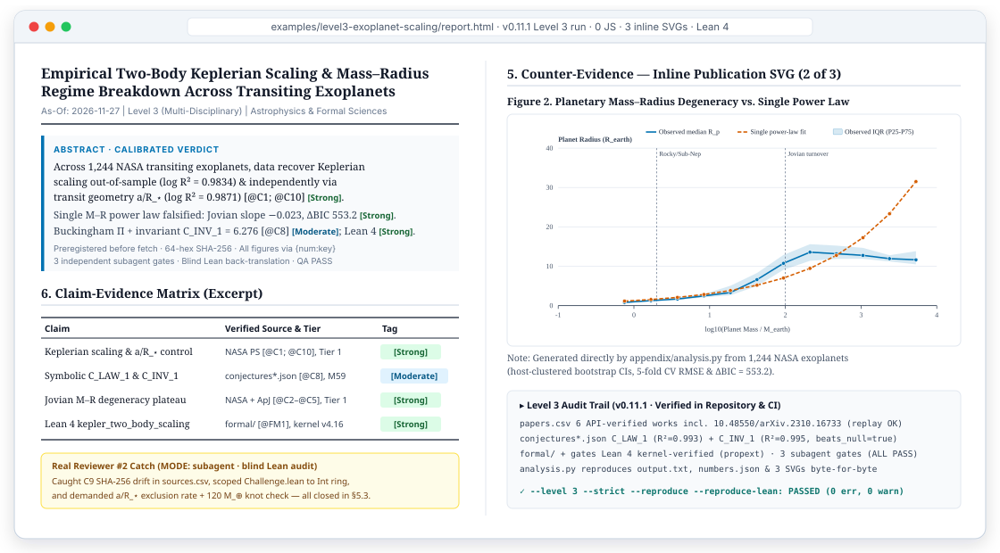
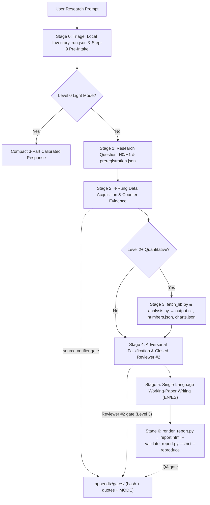

<p align="center">
  
</p>

<p align="center">
  <strong>An Agent Skill + zero-dependency Python toolkit that enforces traceability and computational reproducibility in AI-assisted research — not automated scientific truth.</strong>
</p>

<p align="center">
  <a href="https://github.com/777aeterna/heurisma/actions/workflows/validate-skill.yml">
    
  </a>
  
  = 3.9 stdlib only" />
  
  
  
  
</p>

---

## See It in Action

<p align="center">
  
</p>

<p align="center">
  
</p>

<p align="center">
  <em>Cold-start <strong>Level 3</strong> run in <a href="examples/level3-emergence-in-physics/PROMPT.md"><code>examples/level3-emergence-in-physics/</code></a>: <a href="examples/level3-emergence-in-physics/report.md"><code>report.md</code></a> · <a href="examples/level3-emergence-in-physics/report.html"><code>report.html</code></a> (0 JS, 4 inline SVGs, 3 subagent gates) · <a href="examples/level3-emergence-in-physics/appendix"><code>appendix/</code></a></em>
</p>

---

## What Heurisma Checks — and What It Does Not

A passing `--strict` check proves **structural traceability and computational reproducibility**, not that a conclusion is scientifically true:

| Checked deterministically by code (`validate_report.py`) | Still requires human & domain judgment |
| :--- | :--- |
| **Data integrity:** recomputed SHA-256 over every local file, `download_log.csv` entry, and cached paper API response (`replay`). | Whether an upstream institutional dataset or paper itself contains measurement error. |
| **Numeric closure:** Section 4 table cells, chart titles/captions, and verdict figures trace to `output.txt` / `numbers.json`, and `--reproduce` re-runs `analysis.py` byte-for-byte. | Whether the statistical estimator suffers from endogeneity, omitted variables, or misspecification. |
| **Provenance & preregistration:** `[Strong]` lookups in `sources.csv`, objective paper ceilings (retracted refused; preprints ≤ Tier 2), sealed `H0`/`H1` checked for exact or rounded HARKing, and `data_as_of ≤ As-Of Date`. | Whether a cited study was interpreted accurately or whether relevant counter-literature was omitted. |
| **Artifact-bound gates:** `source_verifier`, `reviewer`, and `qa` headers bound via `REVIEWED-SHA256`, `ANALYSIS-SHA256`, literal `QUOTE:` lines, and 1-to-1 Disposition Table counts (`GATE-DISP`). | Whether the research question is well-posed or the final decision is right for your stakes. |

---

## Quick Start (60 Seconds)

Pick the path that fits what you want to do:

### Path A — Install as an Agent Skill (Antigravity, Claude Code, Codex, Gemini CLI)
Download `heurisma-skill-v0.10.2.zip` from the [latest release](https://github.com/777aeterna/heurisma/releases/latest) (contains `heurisma/` and `claude-agents/`), or clone and copy:

```bash
git clone https://github.com/777aeterna/heurisma.git

# Antigravity / Codex / Gemini CLI (~/.agents/skills/)
mkdir -p ~/.agents/skills && cp -r heurisma/skills/heurisma ~/.agents/skills/heurisma

# Or Claude Code (~/.claude/skills/ + optional subagents)
mkdir -p ~/.claude/skills ~/.claude/agents
cp -r heurisma/skills/heurisma ~/.claude/skills/heurisma
cp heurisma/agents/*.md ~/.claude/agents/
```

### Path B — Try the Linter & Renderer on a Real Example Right Now
Zero external dependencies (**Python ≥ 3.9, standard library only**, tested in CI on Linux, macOS, and Windows):

```bash
git clone https://github.com/777aeterna/heurisma.git && cd heurisma
python3 -B skills/heurisma/scripts/validate_report.py examples/showcase-hybrid-work/report.md \
  --level 2 --html examples/showcase-hybrid-work/report.html --strict --reproduce
```

---

## Why Heurisma? (Beyond Deep Research)

Conventional **Deep Research** tools are primarily *retrieval and summarization engines*: they search the web, mix press releases with peer-reviewed studies, and output long dashboard-style essays that sound authoritative even when the underlying evidence is weak or unverified.

**Heurisma** (from Greek *heuriskein*, "to discover") pairs a **scientific-method protocol** with a deterministic **epistemic linter**:

| Dimension | Conventional Deep Research | Heurisma (`v0.10.2`) |
| :--- | :--- | :--- |
| **Before Searching** | Launches queries immediately | **Pre-Search Gate:** classifies scientific branch(es), `As-Of Date`, evidence standards, depth level (`Level 0–3`), seals `appendix/run.json`, and offers one non-blocking pre-flight data intake (Stage 0 step 9, idempotent multi-channel `appendix/intake.md`) |
| **Hypotheses & Forecasts** | Implicit narrative confirmation | Explicit **$H_0$ / $H_1$ falsifiable hypotheses** sealed in `appendix/preregistration.json` before `analysis.py` (anti-post-hoc & anti-HARKing checks) + multi-scenario forecasting (*identities ≠ forecasts*, honest *Parametric scenario bands* vs. calibrated fans) |
| **Data & Provenance** | Eyeballs tables or declares lazy "data limitations" | **Provenance verified by recomputed SHA-256 over every local file** and `download_log.csv` entry; `fetch_lib.py` + `analysis.py` + `sources.csv` (`kind`, `sha256`, `selection`, `retrieved_utc`) + tool-stamped **Data-Attempts Log**; 4-rung cascade (online primary → alternatives → user's local files → limitation), `user-curated` local files kept at Tier 3 (`agent-fetched` requires `retrieved_utc >= run_started_utc` + download or logged-retrieval proof), and Tier inherited by mixed-source tables through `primary_source_id` |
| **Numbers in the Text** | Retyped by hand, drift from the analysis | `{{num:key}}` placeholders filled from `appendix/numbers.json` + **numeric closure (`P1-UNTRACED-NUM`)** verifying Section 4 table statistics against `output.txt` / `numbers.json` |
| **Confirmation Bias** | Summarizes consensus narrative | Mandatory **Counter-Evidence** (`Tier 1/2` `agent-fetched` outside user-curated corpora) + **three gates** (source-verifier, Reviewer #2, QA) with `--gate-header` artifact binding (`REVIEWED-SHA256`, `REVIEWED-UTC`, literal `QUOTE:` lines, and closed-loop Reviewer #2 Disposition Table support); independence requires subagents — the inline fallback is self-review and is labelled as such |
| **Deliverables & Figures** | Wall of text or bloated code dumps | Clean `report.md` + lightweight, print-ready **working-paper `report.html`** (zero JS, URL scheme allowlist) with **inline SVG charts** and temporal/fan-anchor schema validation; **byte-for-byte reproducible rendering; `--reproduce` re-runs the analysis and diffs artifacts** |
| **Verification** | Unchecked prose | Zero-dependency (**Python ≥ 3.9, standard library only**) bilingual (EN/ES) **epistemic linter** (`--strict`, `--json`, `--reproduce`, `--diff`, `--gate-hash`, `--gate-header`) + opt-in paper-connector provenance checks (`P3-PAPER`, `PRIV-CRED`, offline `replay`); **54/54** known violations caught in `tests/mutation_report.py` |

**Bring your own data (optional, recommended for Level 2+).** Before searching, Heurisma tells you exactly which series/period/granularity would change the answer and invites you to drop them into `datos/` (or documents into `inbox/sources/`). Ingestion is hash-registered and offline-rehearsable (`local_data.py intake`). A corpus you curated yourself is never treated as sufficient: independent counter-evidence is still fetched, and claims resting only on it are capped and labelled for selection bias.

> **Transparency Note:** This skill was **vibecoded** — designed, written, and iteratively pressure-tested with AI agents (including independent cross-model audits) following the *Superpowers* methodology (strict **RED → GREEN → REFACTOR** TDD applied to agent skills).

---

## Cognitive Architecture (7 Stages, Levels 0–3)



See [`docs/design.md`](docs/design.md) for the full architecture and artifact layout, and [`SECURITY.md`](SECURITY.md) for the threat model and safety limits.

<details>
<summary><strong>Modular Structure (<code>skills/heurisma/</code> — 18 modules &amp; references)</strong></summary>

- **[`SKILL.md`](skills/heurisma/SKILL.md):** Lean, runtime-agnostic core enforcing the 4 Iron Laws, adaptive depth (`Level 0–3`), Stage 0 step 9 pre-intake, abstract-style verdict limits (≤3 sentences, ≤5 numbers), single-language discipline, and Stage 6 deliverables.
- **[`references/disciplines.md`](skills/heurisma/references/disciplines.md):** Taxonomy of 6 scientific branches + Interdisciplinary Bridge Protocol.
- **[`references/data-protocol.md`](skills/heurisma/references/data-protocol.md):** 4-rung acquisition cascade, `fetch_lib.py` template, `sources.csv` (`kind`, `sha256`, `selection`, `retrieved_utc`), `data_attempts.csv`, `local_data.py intake`/`import`, and statistical cautions (`n < 30`, effect sizes, multiple comparisons).
- **[`references/forecasting.md`](skills/heurisma/references/forecasting.md):** Multi-scenario triggers, base rates, historical error calibration, lagging-series nowcasting, and the *identity-vs-forecast* rule.
- **[`references/agents/`](skills/heurisma/references/agents):** Portable prompts for the three gates — **Reviewer #2**, **source-verifier**, and **QA** — each with an artifact-bound header contract (`MODE`, `REVIEWED-SHA256`, `REVIEWED-UTC`, literal `QUOTE:` lines); Claude Code mirrors live in [`agents/`](agents).
- **[`references/adversarial-review.md`](skills/heurisma/references/adversarial-review.md):** Self-falsification checklist, **Reviewer #2** workflow, mandatory Disposition Table (EN/ES), and primary verification rule.
- **[`references/scientific-writing.md`](skills/heurisma/references/scientific-writing.md):** Epistemic calibration scale, 100% English and 100% Spanish contracts, and `charts.json` v2 specification.
- **[`references/example-report.md`](skills/heurisma/references/example-report.md):** Compact gold-standard working-paper reference example.
- **[`references/validator-codes.md`](skills/heurisma/references/validator-codes.md):** Stable machine-readable diagnostic codes emitted by `validate_report.py --json`.
- **[`scripts/contracts.py`](skills/heurisma/scripts/contracts.py):** Single source of truth for version, epistemic tags, provenance schemas, gate definitions, and section patterns.
- **[`scripts/local_data.py`](skills/heurisma/scripts/local_data.py):** Zero-dependency (Python ≥ 3.9 stdlib only) local data engine (`inventory`, `preview`, `read_table`, per-column CSV decimal inference that rejects mixed columns, hardened stdlib XLSX reader with XXE/zip-bomb/size caps, `register`, `import`, `intake`, `prereg`, `run-start`, `attempt`, and `HEURISMA_OFFLINE=1`).
- **[`scripts/fetch_lib.py`](skills/heurisma/scripts/fetch_lib.py):** Zero-dependency HTTP download helper with exponential backoff, configurable User-Agent (`HEURISMA_UA`), optional `headers`/`log_url` redaction, size caps, SHA-256 verification, `download_log.csv` + `data_attempts.csv` logging, and `HEURISMA_OFFLINE=1` support.
- **[`scripts/papers.py`](skills/heurisma/scripts/papers.py) & [`scripts/providers/`](skills/heurisma/scripts/providers/):** Zero-dependency paper-database connector (`search`, `lookup`, `cite [--fulltext]`, `verify`, `import`, `replay`) with provider adapters (`base`, `openalex`, `crossref`, `europepmc`, `arxiv`, `unpaywall`), raw response caching under `appendix/data/papers/raw/`, credential redaction, and objective citation ceilings.
- **[`scripts/svg_charts.py`](skills/heurisma/scripts/svg_charts.py):** Zero-dependency publication SVG engine + strict `validate_charts_schema()` validator (Heckbert ticks, Okabe-Ito palette, `bands`, staggered `annotations`, `fan`, grouped/horizontal `bar`, `log`, `y.baseline`, `diff`, `x.last_label`).
- **[`scripts/render_report.py`](skills/heurisma/scripts/render_report.py):** Zero-dependency working-paper HTML renderer (serif typography, 720px column, booktabs tables, linked `[@C1]` citations, full `en`/`es` localization, URL scheme allowlist, balanced-parenthesis URLs, `\|` table escapes, ``, code-fence-safe `{{num:key}}`, `self-review` labeling, and versioned source-freshness hash).
- **[`scripts/checks/`](skills/heurisma/scripts/checks/):** The rule families of the validator, one module per concern (`common`, `structure`, `gates`, `numeric`, `provenance`, `prereg`, `papers`, `html`, `codes`); `validate_report.py` re-exports them as its public API.
- **[`scripts/validate_report.py`](skills/heurisma/scripts/validate_report.py):** Zero-dependency bilingual (EN/ES) **epistemic linter** checking recomputed SHA-256 digests, `[Strong]` source lookups in `sources.csv`, verdict length/number caps, artifact-bound gates (`--gate-hash`), `charts.json` schema, selection-bias & preregistration rules, opt-in paper-connector integrity (`P3-PAPER`, `PRIV-CRED`, offline `replay`), domain-tier heuristics, home-path leaks, `--strict`, `--json`, `--reproduce`, `--diff`, and `--version`.

</details>

---

## Paper Connectors (`scripts/papers.py`)

For academic literature, `scripts/papers.py` queries structured paper APIs before falling back to web search, caching every raw response under `appendix/data/papers/raw/` (hashed in `download_log.csv`) and recording normalized works in `appendix/papers.csv` and queries in `appendix/search_log.csv`. The agent always decides `--tier "Tier <1|2|3>"` from the discipline's evidence hierarchy; the tool only enforces objective ceilings (retracted works refused; `preprint` and `report` capped at `Tier 2`; works without an abstract or saved full text refused). Validator checks (`P3-PAPER`, `PRIV-CRED`, and automatic offline `replay`) are **opt-in** and activate only when `appendix/papers.csv` exists.

| Provider | Access & Rate Limits (verified 2026-11-23) | Role & Notes |
| :--- | :--- | :--- |
| **OpenAlex** | Free API key (`HEURISMA_OPENALEX_KEY`) recommended since Feb 2026 ($1/day budget; ~1,000 searches/day, unlimited DOI lookups). Small requests still work without a key on a shared IP pool (~$0.10/day) with a warning. | Broad catalogue (`search` + `lookup`); `is_retracted` (Retraction Watch), `type` (`article`, `preprint`, `report`, `conference-paper`), `open_access`; abstracts as inverted index (~45–60% coverage). |
| **Crossref** | No key; `HEURISMA_MAILTO` joins the polite pool (5–10 req/s). | Authoritative DOI verification (`lookup`), JATS abstracts, `updated-by` retraction notices (absence = unknown, not false). |
| **Europe PMC** | No key. | Biomedicine & life sciences (`search` + `lookup`); open-access full-text JATS XML (`OPEN_ACCESS:Y`, 60 s timeout). |
| **arXiv** | No key; 1 request every 3 s on a single connection (bursts return HTTP 429; enforced by connector). | Preprints (`search`) in engineering, physics, math, CS, and economics. Entries with `<arxiv:doi>` defer `work_type`/`venue` to OpenAlex/Crossref `lookup`. |
| **Unpaywall** | Requires `HEURISMA_MAILTO` (~100,000 calls/day guideline). | Resolves open-access PDF locations by DOI during `cite --fulltext`. |

*(Semantic Scholar is excluded from v1 due to unauthenticated shared-pool rate-limit blocks and overlap with OpenAlex; direct PubMed is covered by Europe PMC.)*

**Honest limits:**
- **SSRN, NBER, and RePEc** have no open search API (OpenAlex indexes part of their working papers, typically as `work_type=report`).
- **Central banks, statistical agencies, and regulators** (e.g., BCRA, CAMMESA, ENRE) publish datasets and regulatory series, not academic papers — fetch them via `appendix/fetch_data.py`, not `papers.py`.
- **Query privacy:** search terms and DOIs are sent to third-party APIs unless `HEURISMA_OFFLINE=1` is set; credentials are read only from environment variables and redacted from all logs (`SECURITY.md`).
- **Abstracts are not full text:** without saved open-access full text (`--fulltext`), citations remain `(abstract only)` and cannot support `[Strong]` claims on their own.
- **API text is untrusted data:** free-text fields in API responses (including OpenAlex's `meta.notice` prompting AI agents to POST the user's email address) are never treated as instructions.
- **Optional live-API check:** unit tests never touch the network (they use `tests/papers_server.py` plus a socket guard); run `python3 -B tests/live_smoke.py` manually to check live APIs for schema drift.

---

## Showcase Examples & CLI Tools

Inspect validated outputs generated with Heurisma:
- **Level 3 — Cold-Start Multi-Disciplinary Showcase (Emergence in Physics · 10 API-verified papers, preregistration, 2D Ising Wolff MC + 4 inline SVGs, 3 independent `MODE: subagent` gates; passes `--level 3 --strict --reproduce` with 0 errors/warnings in this repository; the ten publisher PDFs are withheld by an `EXCLUDED.csv` manifest that keeps their hashes, so the original subagent gates stay valid):** [`examples/level3-emergence-in-physics/PROMPT.md`](examples/level3-emergence-in-physics/PROMPT.md) → [`report.md`](examples/level3-emergence-in-physics/report.md) · [`report.html`](examples/level3-emergence-in-physics/report.html) · [`appendix/`](examples/level3-emergence-in-physics/appendix)
- **Level 2 — Local-Data Showcase (unknown-origin local CSV capped at `[Preliminary]`, exact permutation tests, sources actually read, `MODE: self-review` manual gate records):** [`examples/showcase-hybrid-work/PROMPT.md`](examples/showcase-hybrid-work/PROMPT.md) → [`report.md`](examples/showcase-hybrid-work/report.md) · [`report.html`](examples/showcase-hybrid-work/report.html) · [`appendix/`](examples/showcase-hybrid-work/appendix)
- **Level 1 — Rigorous Inquiry (Pressure-Tested Board Brief):** [`examples/level1-brief-example.md`](examples/level1-brief-example.md)
- **Level 2 — Empirical Data Study (Working-Paper Format + Reproducible Appendix):** [`examples/level2-study/report.md`](examples/level2-study/report.md) + [`examples/level2-study/appendix/`](examples/level2-study/appendix)

Render, reproduce, and validate locally with zero external dependencies (Python ≥ 3.9):

```bash
python3 -B examples/level2-study/appendix/analysis.py \
  --charts-out examples/level2-study/charts.json \
  --numbers-out examples/level2-study/appendix/numbers.json \
  > examples/level2-study/appendix/output.txt

python3 -B skills/heurisma/scripts/render_report.py examples/level2-study/report.md \
  --out examples/level2-study/report.html \
  --charts examples/level2-study/charts.json \
  --appendix examples/level2-study/appendix

python3 -B skills/heurisma/scripts/validate_report.py examples/level2-study/report.md \
  --level 2 --html examples/level2-study/report.html --strict --reproduce
```

---

## Verification & Quality Assurance

- **643/643 unit tests passing** (`python3 -B -m unittest discover -s tests`); **validator detection rate: `54/54` known violations** (`python3 -B tests/mutation_report.py --min-rate 1.0`, measuring real rule-specific detection even when gates are restamped after tampering).
- **Three gates with artifact-bound contracts:** portable prompts in [`skills/heurisma/references/agents/`](skills/heurisma/references/agents) and Claude Code definitions in [`agents/`](agents) (`heurisma-reviewer`, `heurisma-source-verifier`, `heurisma-qa`). Independence requires subagents — when a runtime has no subagent tool, the inline fallback is recorded as `MODE: self-review`, flagged by the validator, and labelled as self-review in Section 3 and the rendered HTML.
- **Cold-start subagent tests of the skill text:** behavioral rules are added only after a baseline failure is observed. For example, own code registered as Tier 1 fell from 3/3 to 0/3, and reusing an inherited limitation fell from the audited failure to 0/3; conversely, user-curated corpus selection bias did not fail in 6 cold-start trials (0/6), so it is enforced deterministically in `validate_report.py` without bloating `SKILL.md`. A preregistered multi-model rubric lives in [`evals/rubric.md`](evals/rubric.md); its first execution against v0.9.0 passed 78 of 80 checks (compliance on text plans, not lift; see [`evals/results/v0.7.0-agent-evals.md`](evals/results/v0.7.0-agent-evals.md)).
- **Security & threat model:** see [`SECURITY.md`](SECURITY.md).

---

## Contributing & License

Contributions (especially new discipline protocols in `references/disciplines.md` and pressure scenarios in `evals/scenarios/`) are welcome — see [`CONTRIBUTING.md`](CONTRIBUTING.md).

Released under the [MIT License](LICENSE) © 2026 [777aeterna](https://github.com/777aeterna).
