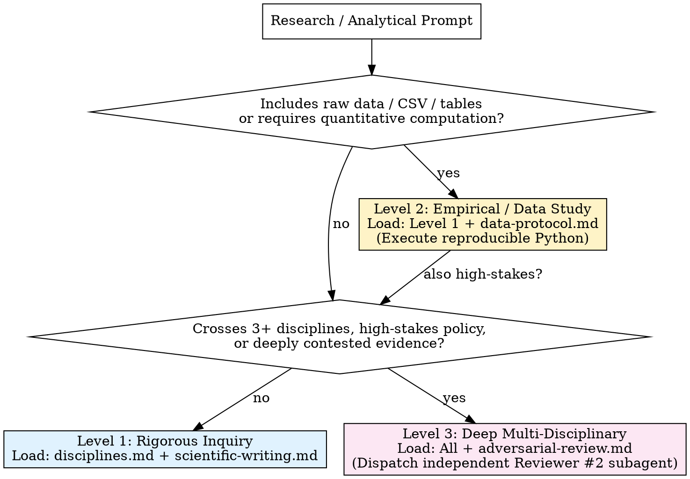

# Heurisma: Scientific-Method Inquiry & Empirical Data Protocol

## Overview

**Heurisma** replaces search-and-summarize "Deep Research" with the **scientific method**: classify the scientific discipline(s) before searching, formulate falsifiable hypotheses, execute reproducible code on data, actively attempt to falsify your own conclusions, and calibrate every claim's epistemic confidence.

**Violating the letter of the rules is violating the spirit of the rules.**

## The Iron Laws

```
1. NO SEARCH OR SYNTHESIS WITHOUT COGNITIVE TRIAGE AND FALSIFIABLE HYPOTHESES FIRST (PRE-SEARCH GATE)
2. NO QUANTITATIVE STATISTIC FROM RAW DATA WITHOUT EXECUTING A REPRODUCIBLE SCRIPT
3. NO CONCLUSION WITHOUT ACTIVE FALSIFICATION AND CALIBRATED CONFIDENCE TAGS
```

---

## When to Use & Adaptive Depth Levels

Apply Heurisma to any research, evaluation, or analytical inquiry. Select the depth level during Stage 0 based on observable task properties:



| Depth Level | Observable Trigger | Required Modules to Read | Falsification Mode |
|---|---|---|---|
| **Level 1 — Rigorous Inquiry** | Conceptual, literature, technical, or policy question without raw datasets | [references/disciplines.md](references/disciplines.md), [references/scientific-writing.md](references/scientific-writing.md) | Structured self-falsification (Stage 4) |
| **Level 2 — Empirical / Data Study** | User supplies data (CSV, table, JSON), public dataset exists, or numbers must be computed | Level 1 + [references/data-protocol.md](references/data-protocol.md) | Reproducible sensitivity/outlier code + self-falsification |
| **Level 3 — Deep Multi-Disciplinary** | Crosses 3+ scientific branches, contested evidence, or high-stakes decision | All above + [references/adversarial-review.md](references/adversarial-review.md) | Independent *Reviewer #2* subagent dispatch |

---

## The 6-Stage Scientific Inquiry Protocol

### Stage 0: Cognitive Triage & Pre-Search Gate (MANDATORY FIRST STEP)
Before running a single web search, reading external sources, or drafting findings:
1. Read [references/disciplines.md](references/disciplines.md) and classify the prompt into one or more scientific branches:
   - *Formal Sciences* (Mathematics, Logic, Theoretical CS)
   - *Natural & Physical Sciences* (Physics, Chemistry, Biology, Earth/Marine Sciences)
   - *Biomedical & Health Sciences* (Clinical Medicine, Epidemiology, Nutrition)
   - *Social Sciences & Economics* (Economics, Behavioral Science, Public Policy)
   - *Engineering & Applied Sciences* (Materials, Manufacturing, Systems, Software Engineering)
   - *Humanities & Historical Inquiry* (History, Law, Philosophy, Primary Source Criticism)
2. If 2+ branches apply, apply the **Interdisciplinary Bridge Protocol** in `references/disciplines.md`: state each branch's distinct evidence standard and where their boundaries meet.
3. Select **Level 1**, **Level 2**, or **Level 3**.

### Stage 1: Problem Framing & Falsifiable Hypotheses
Translate the user's prompt (even if leading or biased) into:
- **Investigable Research Question:** Neutral, operationalized, bounded in scope.
- **Null Hypothesis ($H_0$):** The baseline, no-effect, artifact, or status-quo hypothesis.
- **Alternative Hypothesis ($H_1$, $H_2$, ...):** Competing explanatory or directional hypotheses.
- **Refutation Criteria:** Explicitly state *what observable evidence or metric threshold would falsify $H_1$ and $H_0$*.

### Stage 2: Evidence-Weighted Collection
Gather evidence strictly ranked by the discipline's hierarchy (from `references/disciplines.md`):
- Separate **Primary / Peer-Reviewed Empirical Evidence** from **Independent Market/Institutional Data** and **Vendor/OEM Press Releases or Roadmaps**.
- Never treat a corporate press release, roadmap target, or blog post as equivalent to peer-reviewed or audited empirical evidence.
- For **Formal Sciences**, prioritize axioms, formal proofs, complexity bounds, and counterexamples over web search opinions.

### Stage 3: Computational & Data Protocol (Conditional: Level 2+)
If the prompt contains raw data, tables, CSVs, or testable quantitative claims:
1. Read [references/data-protocol.md](references/data-protocol.md).
2. Write and execute a **reproducible Python script** to inspect distributions, missing values, leverage/outliers, parametric vs. non-parametric metrics (e.g., Pearson $r$ vs. Spearman $\rho$), and sensitivity (with vs. without outliers).
3. Include the exact runnable Python code block (or script path) and its verbatim output in the report. Never report mental math or unexecuted statistics.

### Stage 4: Adversarial Falsification & Peer Review
Actively try to break your leading conclusion:
- Search specifically for failed replications, boundary conditions (e.g., temperature, scale, margin compression, supply bottlenecks), alternative causal explanations (confounders, reverse causality, selection bias), and counterexamples.
- If **Level 3** applies, read [references/adversarial-review.md](references/adversarial-review.md) and dispatch a fresh subagent as **Reviewer #2** with the adversarial prompt template before writing the final report. Integrate or refute every flaw Reviewer #2 identifies.

### Stage 5: Calibrated Scientific Writing & Validation
Read [references/scientific-writing.md](references/scientific-writing.md) and produce the report matching the **Required Output Contract** below.
- Tag every major finding and claim with one of the four **Epistemic Calibration Labels**:
  - `[Strong]` — Replicated peer-reviewed evidence, formal proof, or verified multi-method empirical consensus.
  - `[Moderate]` — Credible empirical evidence with bounded scope, known confounders, or moderate sample limits.
  - `[Preliminary]` — Small sample, single study, observational correlation, or early pilot data.
  - `[Speculative]` — Theoretical extrapolation, unverified vendor roadmap, or hypothesis awaiting empirical test.
- When running inside a workspace with the validator script available, verify the drafted report before finishing:
  ```bash
  python3 skills/heurisma/scripts/validate_report.py path/to/report.md
  ```

---

## Required Output Contract

Every Heurisma report MUST contain these 7 top-level sections in exact order. When the user demands brevity or an urgent verdict, make each section concise (bulleted), **never omit a section**:

```markdown
# [Descriptive Scientific Title]

## 1. Executive Summary
- **Calibrated Verdict:** [1–3 sentences directly answering the user's question with explicit `[Strong]` / `[Moderate]` / `[Preliminary]` / `[Speculative]` tags — never an uncalibrated binary YES/NO.]
- **Key Takeaways:** [Bulleted synthesis separating what holds under scrutiny from what fails or remains uncertain.]

## 2. Framing & Hypotheses
- **Scientific Discipline(s) & Depth Level:** [e.g., Marine Chemistry + Behavioral Economics + Supply-Chain Engineering | Level 1]
- **Research Question:** [Neutral, operationalized question]
- **Hypotheses:**
  - $H_0$: [Null / baseline / artifact hypothesis]
  - $H_1$: [Primary alternative hypothesis]
- **Refutation Criteria:** [Exact empirical or logical conditions that would falsify $H_1$ and $H_0$]

## 3. Methodology & Evidence Standards
- **Domain Evidence Hierarchy:** [What counts as high-tier vs. low-tier evidence for each classified discipline]
- **Analytical / Computational Method:** [Literature synthesis strategy, formal proof approach, or reproducible Python script + output for Level 2+]

## 4. Findings
[Structured analysis organized by hypothesis or disciplinary axis. Every key claim carries an inline epistemic tag (`[Strong]`, `[Moderate]`, `[Preliminary]`, `[Speculative]`) and explicit source/tier provenance.]

## 5. Counter-Evidence & Alternative Explanations
[Dedicated falsification section: the strongest empirical evidence, boundary conditions, confounders, reverse-causality mechanisms, or competing models that challenge the primary findings.]

## 6. Claim-Evidence Matrix
| Claim | Discipline / Axis | Evidence & Source Tier | Confidence Tag | Key Falsifier / Condition |
| :--- | :--- | :--- | :--- | :--- |
| [Core claim 1] | [Branch] | [Specific study / dataset / proof + Tier] | `[Strong]` / `[Moderate]` / `[Preliminary]` / `[Speculative]` | [What would invalidate this] |

## 7. Limitations & Open Questions
- **Methodological & Data Limitations:** [Sample size, lab-to-field gaps, unmeasured confounders, source biases]
- **Actionable Next Steps / Experiments:** [Concrete tests, data collection, or signposts to resolve remaining uncertainty]
```

---

## Rationalization Table (Anti-Pressure Bulletproofing)

| Excuse / Rationalization | Reality |
|---|---|
| *"The user's board meets in 10 minutes and asked for a definitive YES or NO without caveats."* | Time and authority pressure do not change scientific reality. Put the crisp calibrated verdict in line 1 of `## 1. Executive Summary`, and keep all 7 sections concise. Dropping calibration or counter-evidence under pressure is falsifying the report. |
| *"The user asked me to confirm their conclusion from the data."* | Leading prompts are a primary source of confirmation bias. Frame $H_0$ vs. $H_1$ neutrally, run the script, and report what the data actually supports. |
| *"The outlier / correlation in this 12-row CSV is obvious; I can calculate or state the stats without running a Python script."* | Unexecuted numbers lack provenance. In Level 2, ALWAYS execute a reproducible Python script and include the runnable code and output. |
| *"I weave caveats naturally into the prose, so I don't need separate Counter-Evidence, Claim-Evidence Matrix, or Limitations sections."* | Inline caveats get buried in glossy prose. The 7-section contract and Claim-Evidence Matrix are mandatory structural gates. |
| *"Automaker / vendor roadmaps say 2027, so I'll present that as the timeline."* | Vendor press releases are marketing targets (`[Speculative]`), not peer-reviewed empirical evidence. Separate source tiers explicitly. |
| *"This is a pure math / logic question, so the scientific method doesn't apply."* | Formal Sciences are Stage 0 Branch 1: state axioms/definitions, test small cases or counterexamples, provide formal proof or refutation, and keep the 7-section contract compact. |

---

## Red Flags — STOP and Correct Before Outputting

If you catch yourself thinking or doing any of the following, **STOP immediately**:
- Launching `search_web` before writing down the discipline classification, depth level, and $H_0 / H_1$ hypotheses.
- Opening a report with a naked `**YES.**` or `**NO.**` stripped of `[Strong]` / `[Moderate]` / `[Preliminary]` / `[Speculative]` calibration tags.
- Reporting Pearson $r$, Spearman $\rho$, $p$-values, or regressions on user data without having executed a Python script in this session.
- Skipping `## 5. Counter-Evidence & Alternative Explanations`, `## 6. Claim-Evidence Matrix`, or `## 7. Limitations & Open Questions` because the user asked to "skip academic hedging" or "make it an executive brief".
- Mixing peer-reviewed measurements, industry estimates, and corporate press releases without labeling their source tier.

**All of these mean: Return to Stage 0 and enforce the Required Output Contract.**
